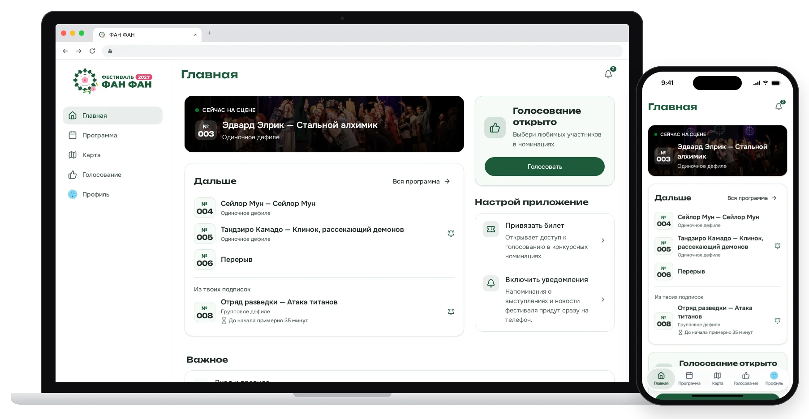
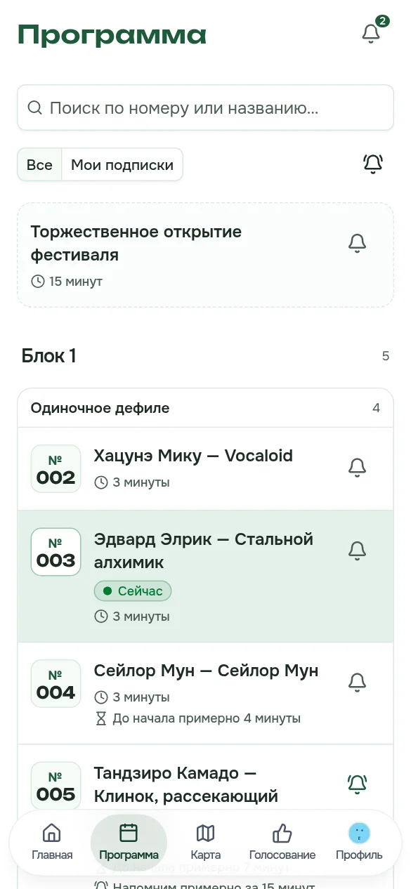
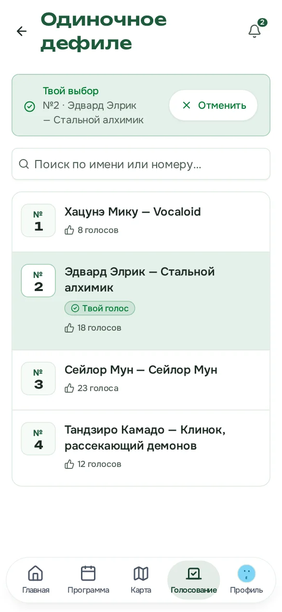
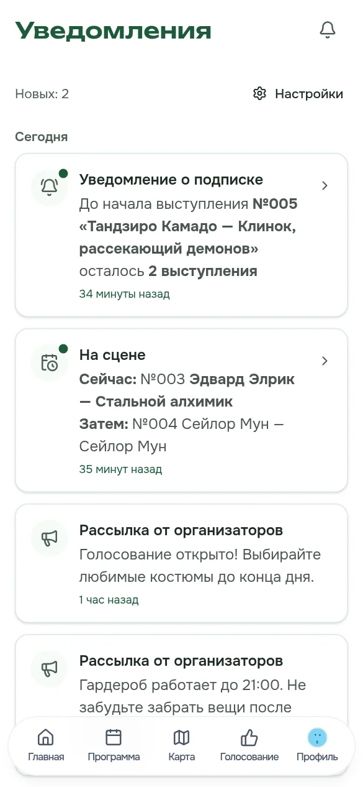
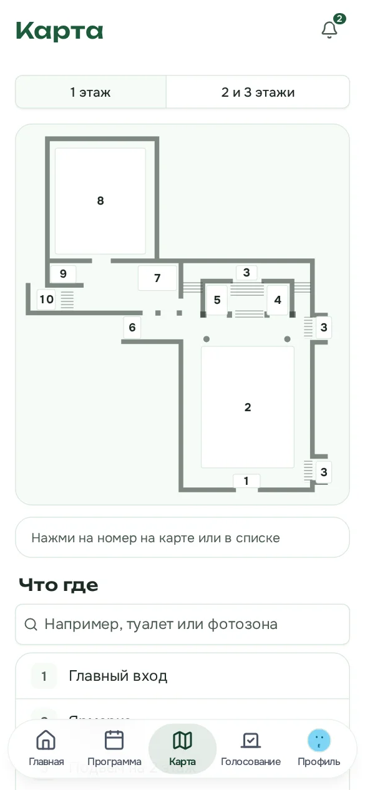
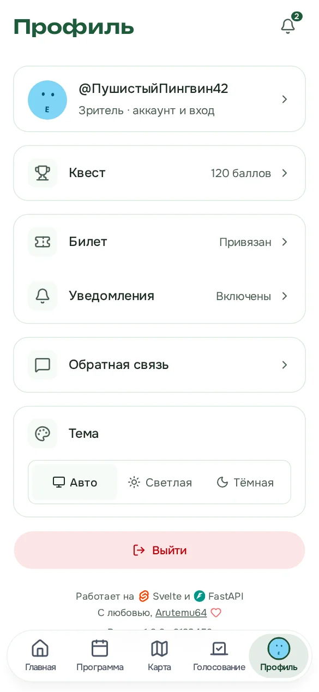
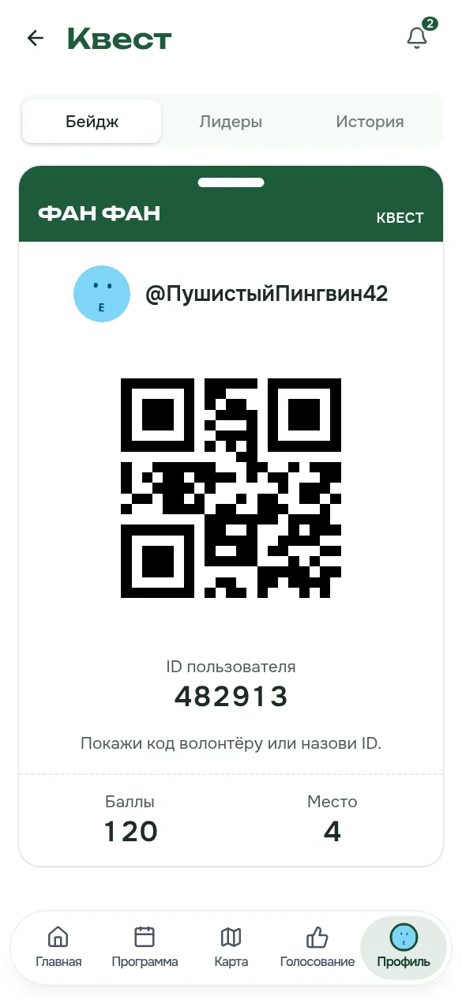

# FAN FAN companion app

[](https://github.com/Arutemu64/fanapp/actions/workflows/ci.yml?query=branch%3Amain)
[](#license)

FAN FAN is a mobile-first companion web app for a Russian anime convention.
Attendees can follow the live schedule, vote, get notifications, find their way
around the venue, and link their tickets. Organizers manage the event from the
same app. The interface is in Russian.

## Getting started

Install Docker with Compose and the tools pinned in [`mise.toml`](mise.toml) and
[`.python-version`](.python-version). If you use [mise](https://mise.jdx.dev), run
`mise install` for Python, Node.js, pnpm, uv, and just. Install Docker separately.
On Windows, run `just` from Git Bash or WSL.

Run these from the repository root.

```sh
just setup
just dev
```

`just setup` installs the locked dependencies and prepares local configuration and
keys. `just dev` starts the frontend, API, worker, Postgres, and NATS with hot
reload and applies database migrations.

When the stack is ready, load sample programme and voting data in a second terminal.

```sh
just demo
```

Open [localhost:3000](http://localhost:3000) to see the schedule. To sign in,
use email login and read the code in the API output from `just dev`. The local
setup works without external credentials.

### Advanced: run app processes on the host

See [host development](CONTRIBUTING.md#run-app-processes-on-the-host) for running
the API, worker, and frontend outside Docker. The contributor guide also covers
[local configuration](CONTRIBUTING.md#local-configuration).

## Features



- **Festival day** shows the countdown before doors open, the current and next acts during the festival, and a feedback link afterwards. The festival guide and searchable floor plans help attendees find their way around.
- **Schedule and voting** update live. Attendees can subscribe to scheduled acts and vote in cosplay nominations synced from Cosplay2.
- **Accounts and tickets** support email codes, credentials, and deployment-specific VK ID and Telegram sign-in. Attendees can link TicketsCloud tickets and receive in-app and Web Push notifications.
- **Installable web app** keeps the schedule, notifications, and profile readable offline.
- **Staff tools** let organizers import schedules and sync ticket and cosplay data. In the optional quest, volunteers award points by scanning attendees’ QR codes, and attendees can check the leaderboard.

### Screenshots

The gallery shows the Spring 2027 edition with sample festival data. Select a
screenshot to view it at full size.

[](docs/assets/readme-gallery/schedule.webp)
[](docs/assets/readme-gallery/voting.webp)
[](docs/assets/readme-gallery/notifications.webp)
[](docs/assets/readme-gallery/map.webp)
[](docs/assets/readme-gallery/profile.webp)
[](docs/assets/readme-gallery/quest.webp)

## Repository layout

- [`backend/`](backend/) contains the FastAPI app and worker. The stack uses PostgreSQL and NATS JetStream.
- [`frontend/`](frontend/) contains the SvelteKit app with TanStack Query, shadcn-svelte, and Tailwind CSS.
- [`shared/`](shared/) contains the OpenAPI contract. See [API integration](docs/api.md) for how to regenerate the client after changing the API.

## Deployment

See the [deployment guide](docs/deployment.md) for runtime configuration,
publishing and deploying images, and rolling back. Use `just run-prod` to build
and try the production configuration locally.

### Running this for your own event

Fork the repository, replace the festival branding, and publish your own
images. The published FAN FAN images include this festival's branding and
frontend configuration, including its Web Push public key and error-reporting
DSN. Follow the [deployment steps for a fork](docs/deployment.md#reusing-this-for-another-event).

## Contributing

See [CONTRIBUTING.md](CONTRIBUTING.md) for setup, checks, and pull requests.
Run `just --list` for the full command list. Ask questions and report bugs in
[GitHub Issues](https://github.com/Arutemu64/fanapp/issues).

## Documentation

- [Backend architecture](docs/backend.md) and [frontend conventions](docs/frontend.md)
- [Testing](docs/testing.md) and [dependency pins](docs/dependencies.md)
- [Architecture decision records](docs/adr/README.md) and [repository guidelines](AGENTS.md)

## Project history

> [!NOTE]
> **This project is built with AI.** It started as a
> [Telegram bot](https://github.com/Arutemu64/fanfan-bot), written entirely by hand
> in Python, and later grew into a full-stack PWA. I don't write frontend, so the
> Svelte 5 / SvelteKit side is largely AI-generated; the backend is now written with
> heavy AI assistance too, as are most of the docs. The architecture, data model and
> requirements are mine, and I review everything before it lands.

## Security

Report vulnerabilities privately using [SECURITY.md](SECURITY.md). Use the local
stack for security testing.

## License

[MIT](LICENSE) © Arutemu64. The MIT grant covers the **source code**. Two
categories of files in this repository are excluded from it.

**Festival branding and artwork.** The FAN FAN name, logo, festival maps and
event photography belong to the festival, not to this codebase, and carry no
license to reuse. The event photo in particular shows identifiable attendees,
who consented to a festival photo, not to redistribution under MIT. Excluded:

- `backend/src/fanfan/common/static/logo.png`
- `frontend/static/icons/`
- `frontend/static/favicon.ico` and `frontend/static/og-image.png`
- `frontend/src/lib/data/maps.ts` (floor plans traced from the festival's maps)
- `frontend/src/routes/(app)/components/home/main.webp`
- `docs/assets/readme-header.webp`
- `docs/assets/readme-gallery/`

Fork the code freely; swap in your own branding.

**Vendored third-party agent skills** live under `.agents/skills/`. Each keeps its
upstream license and copyright. `skills-lock.json` records each source repository.
