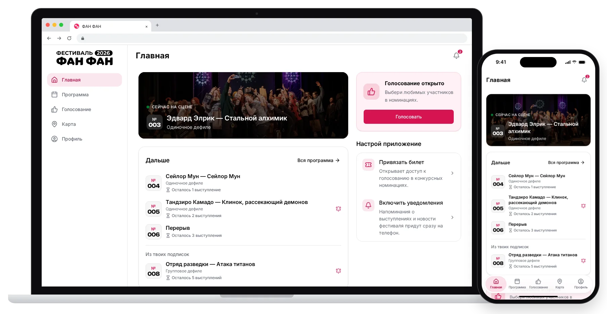
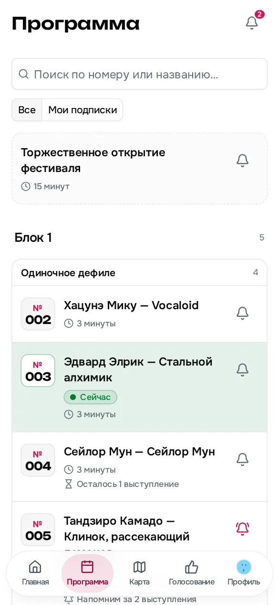
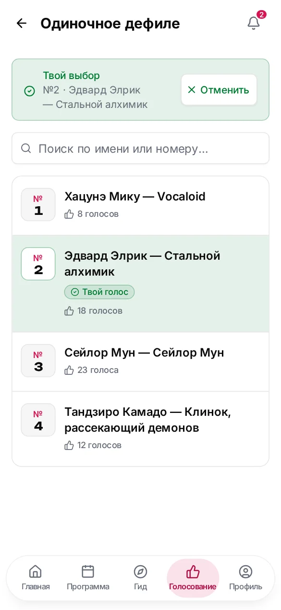
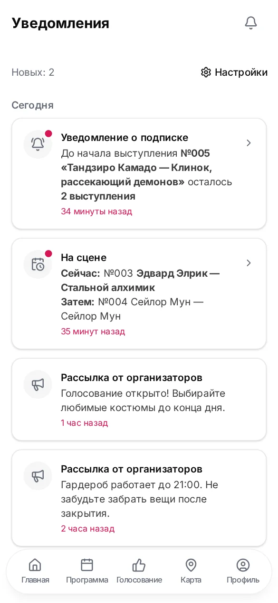
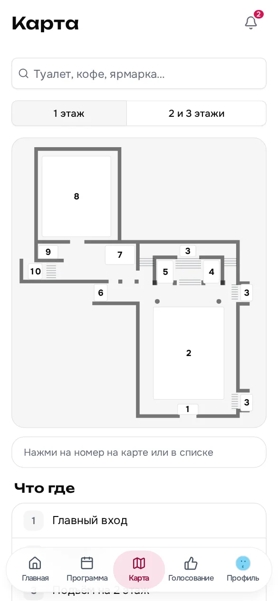
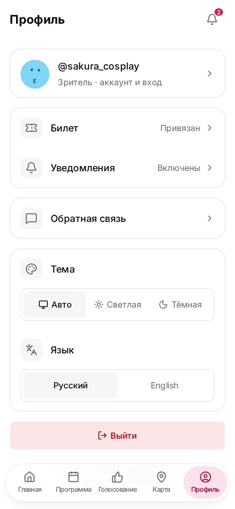
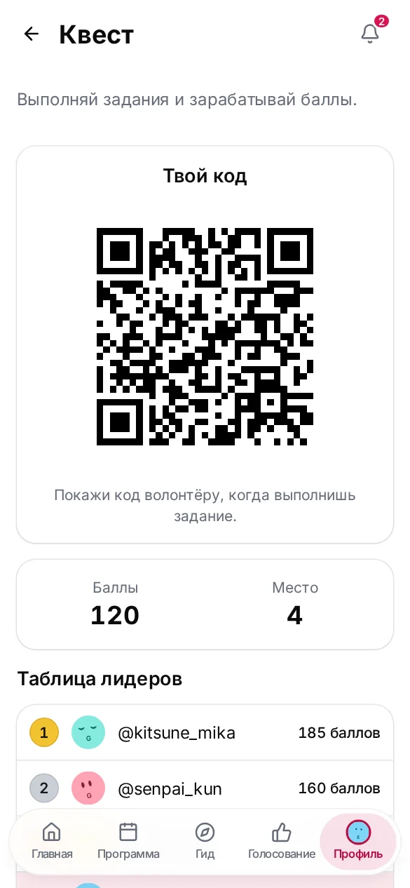

# FAN FAN

[](https://github.com/Arutemu64/fanapp/actions/workflows/ci.yml?query=branch%3Amain)
[](#license)



Companion web app for the **FAN FAN** Russian anime convention. It gives attendees the event schedule, voting, notifications, and ticket-linked profiles from their phone, and gives organizers the tools to run all of it. Audience is teen to young-adult and non-technical, so the UI is mobile-first and all user-facing copy is in Russian.

This is a monorepo: a FastAPI backend, a SvelteKit frontend, and a shared OpenAPI contract between them.

> [!NOTE]
> **This project is built with AI.** It started as a
> [Telegram bot](https://github.com/Arutemu64/fanfan-bot), written entirely by hand
> in Python, and later grew into a full-stack PWA. I don't write frontend, so the
> Svelte 5 / SvelteKit side is largely AI-generated; the backend is now written with
> heavy AI assistance too, as are most of the docs. The architecture, data model and
> requirements are mine, and I review everything before it lands.

## Features

- **Home**: changes with the festival: a countdown before it, the act on stage and what's next during it, thanks and a feedback prompt after. An "open voting" card shows while voting runs, and a setup list (account, ticket, subscriptions, notifications, install) shows each person only the steps they still have. Below them sits the festival guide: the address and doors time, the rules, a page per festival activity, and social links. The activity pages are Markdown files in `frontend/src/content/guide/`, compiled with mdsvex, so adding or rewording one is a file edit ([ADR-0028](docs/adr/0028-mdsvex-for-guide-articles.md)).
- **Schedule**: public event schedule with live changes, per-user subscriptions, and organizer management/import tools.
- **Voting**: nominations and voting, with cosplay data synced from Cosplay2.
- **Notifications**: in-app feed plus Web Push (VAPID) for broadcasts and per-user alerts.
- **Auth**: sign in via VK ID or Telegram (social providers are enabled per deployment), email code, one-time login code, or credentials; cookie-based sessions.
- **Profiles & tickets**: user profile, linked tickets (synced from TicketsCloud), account connections, and security settings.
- **Map**: the venue's floor plans with a numbered «Что где» list, searchable across every floor.
- **Quest** (optional, off by default): players show a QR code from their profile, volunteers scan it and award points for tasks done around the venue, and a leaderboard ranks everyone, top places winning merch. Organizers switch it on and set the per-award cap from the festival settings ([ADR-0035](docs/adr/0035-quest-points-as-an-award-ledger.md)).
- **Staff tools**: schedule import, manual TicketsCloud / Cosplay2 syncs, quest awards and other admin screens for organizers and volunteers, each tool shown only to those granted its permission.
- **Feedback**: user feedback submission.
- **Live updates**: Server-Sent Events (SSE) push real-time changes to the client.
- **Installable PWA**: installs to the home screen; screens show their last copy at once and refresh in the background, and the schedule, notifications and profile stay readable offline.

### Screenshots

<table>
  <tr>
    <th>Schedule</th>
    <th>Voting</th>
    <th>Notifications</th>
    <th>Map</th>
    <th>Profile</th>
    <th>Quest</th>
  </tr>
  <tr>
    <td></td>
    <td></td>
    <td></td>
    <td></td>
    <td></td>
    <td></td>
  </tr>
</table>

## Stack

| Layer        | Tech                                                                                                                          |
| ------------ | ----------------------------------------------------------------------------------------------------------------------------- |
| Frontend     | SvelteKit (Svelte 5 runes), TanStack Query (server state, offline cache in IndexedDB), shadcn-svelte, Tailwind CSS v4, `pnpm` |
| Backend      | FastAPI, SQLAlchemy + Alembic, Dishka (DI), `uv`                                                                              |
| Data / infra | PostgreSQL, NATS + FastStream                                                                                                 |
| Jobs         | `worker`: FastStream consumers (domain events), NATS JetStream message schedules (periodic syncs), outbox relay               |
| Tooling      | Docker Compose, `just` task runner                                                                                            |

The backend follows clean / hexagonal architecture: pure `core` and `application` layers, with infrastructure behind ports in `adapters`. See [`AGENTS.md`](AGENTS.md) and [`docs/`](docs/) for the full guidelines.

## Requirements

- Python 3.14 and [`uv`](https://docs.astral.sh/uv/)
- Node.js 24 (LTS) and [`pnpm`](https://pnpm.io/)
- [`just`](https://github.com/casey/just)
- Docker + Docker Compose (for the full environment)
- On **Windows**, run `just` from **Git Bash** (ships with
  [Git for Windows](https://git-scm.com/download/win)) or **WSL**, not cmd/PowerShell,
  since the recipes are POSIX shell.

> Optional: [`mise`](https://mise.jdx.dev) (or `asdf`) reads the pinned
> versions from [`mise.toml`](mise.toml). Run `mise install` to get the exact
> Python / Node / pnpm / uv / just this repo expects in one step. Docker is not
> managed by mise; install it separately.

## Getting started

### Default: develop in Docker

Install the tools listed above (or run `mise install`), then:

```sh
just setup       # install backend/frontend dependencies and bootstrap .env + VAPID keys
just dev         # start the full stack with hot reload
```

Open http://localhost:3000. The API is at http://localhost:8000.
Compose starts the frontend, API, worker, Postgres and NATS, and applies migrations.
Stop the stack with Ctrl+C; database volumes are kept.

`just setup` can be rerun: bootstrap preserves existing configuration and secrets.
It installs host dependencies too, so editor tooling and local checks are ready.
`just bootstrap` remains available when you only need to create configuration.

No external credentials are needed. Fresh configuration disables social login;
use email login and read the code in the worker logs (`docker compose logs worker`).
SMTP is optional: without it, emails are logged instead of sent. Telegram and VK
placeholders let the app start but do not enable working integrations. To use
social login, supply real credentials and set `WEB__ENABLED_OAUTH_PROVIDERS`
(for example, `["vk"]`). Set `PUSH__SUBSCRIBER` to your contact email before
using Web Push outside local development.

To populate an empty local database, run this in another terminal once the app starts:

```sh
just demo        # demo programme, participants and voting; safe to rerun
```

Existing `.env` files are kept as-is. If an older local setup shows an unconfigured
social login button, set `WEB__ENABLED_OAUTH_PROVIDERS=[]` in that file.

`just run-dev` remains an alias for the same Docker workflow. Use `just run-prod`
to build and test production images locally, including the backup service.
Use `just dev --build` to rebuild development images. Production builds rebuild
by default; `just run-prod --no-build` reuses existing images. These are explicit
flags; arbitrary Compose arguments are not accepted. Deployment is covered separately below.

Set `FRONTEND_PORT` / `API_PORT` in `.env` if the default ports are taken.
Update `WEB__PUBLIC_URL` and `PUBLIC_SITE_URL` to match the frontend address.

### Advanced: run app processes on the host

After `just setup`, start the backing services and apply migrations:

```sh
just run-infra
just backend-migrate
```

Then run each app process in its own terminal:

```sh
just backend-dev
just backend-worker
just frontend-dev
```

The worker is required for email login codes, notifications and other background
work. All three processes reload on save. Use `just backend-seed-demo` to seed
this setup and `just stop-infra` to stop its containers while keeping data.

Host processes read the root `.env`; no frontend env file is needed.
`DB__HOST` and `NATS__HOST` stay `localhost` there. Compose overrides them with
its service names when running the app in containers.

## External integrations

Optional, enabled via `.env`:

- **TicketsCloud** (`TCLOUD__*`): ticket sync.
- **Cosplay2** (`COSPLAY2__*`): cosplay / voting data sync.
- **FestEngine** (`FESTENGINE__WEBHOOK_SECRET`): the stage console sets the current act, skips and moves acts over signed webhooks. Unset = disabled. See [docs/backend.md](docs/backend.md) "FestEngine webhook".
- **ALTCHA captcha** (`ALTCHA__HMAC_KEY`, generated by `just bootstrap`): self-hosted proof-of-work on login-code requests, verified inside the API with no third-party service. Unset = captcha off. A per-IP limit on the same endpoint applies either way (see [ADR-0037](docs/adr/0037-self-hosted-altcha-over-yandex-smartcaptcha.md)).
- **Sentry / GlitchTip** (`DEBUG__SENTRY_DSN` backend, `PUBLIC_SENTRY_DSN` frontend): error reporting. Empty DSN = disabled.
- **Umami** (`PUBLIC_UMAMI_SCRIPT_URL`, `PUBLIC_UMAMI_WEBSITE_ID`): cookieless page views and feature events. Either empty = disabled. See [docs/frontend.md](docs/frontend.md) "Analytics".
- **Scheduler** (`SCHEDULER__SYNC_*_CRON`): cron strings (in `TIMEZONE`) that run the syncs periodically. Unset = disabled. The retention jobs (`SCHEDULER__*_RETENTION_CRON`) run nightly by default; set one empty to turn it off. They run as NATS message schedules; after editing, `docker compose restart worker`. Trigger a sync manually any time from **Инструменты → Синхронизация** in the app (needs the `sync:run` permission), or on the server with `docker compose run --rm api cli sync tcloud`.

## Common commands

All commands run from the repo root via `just`.

| Command                                    | What it does                                                                             |
| ------------------------------------------ | ---------------------------------------------------------------------------------------- |
| `just setup`                               | Install locked dependencies and bootstrap local configuration                            |
| `just dev`                                 | Start the full Docker development stack with hot reload                                  |
| `just demo`                                | Seed demo data in the running Docker development stack                                   |
| `just run-infra` / `just stop-infra`       | Start / stop the backing services (Postgres, NATS) alone                                 |
| `just backend-dev` / `just frontend-dev`   | Start backend / frontend on the host                                                     |
| `just backend-worker`                      | Start the FastStream worker (outbox relay, consumers, periodic jobs) on the host         |
| `just backend-migrate`                     | Apply Alembic migrations                                                                 |
| `just backend-seed-demo`                   | Fill an empty environment with a demo programme and voting (idempotent)                  |
| `just backend-generate <name>`             | Autogenerate a migration against the running app DB                                      |
| `just backend-generate-auto <name>`        | Autogenerate a migration against a throwaway Postgres (needs Docker)                     |
| `just backend-check`                       | Check formatting, lint, types and import rules without fixing files                      |
| `just backend-typecheck`                   | Run `ty` type checker                                                                    |
| `just backend-test`                        | Backend unit tests (no Docker); `just backend-test-integration` for the integration tier |
| `just frontend-check`                      | Check formatting, lint and types, frontend                                               |
| `just root-lint` / `just root-format`      | Check / fix Prettier formatting of Markdown and YAML outside `frontend/`                 |
| `just frontend-test` / `just frontend-e2e` | Vitest unit tests / Playwright E2E against a production build                            |
| `just frontend-generate-api`               | Regenerate the OpenAPI spec and the frontend API client                                  |
| `just backend-sync tcloud`                 | Sync tickets from TicketsCloud                                                           |
| `just backend-sync cosplay2`               | Sync cosplay data from Cosplay2                                                          |
| `just deploy`                              | Server deploy: pull prebuilt images and restart                                          |

The full list is `just --list`.

> The frontend talks to the backend through a generated, type-safe client in `frontend/src/lib/api/generated/` (produced by [`@hey-api/openapi-ts`](https://heyapi.dev/)), along with the [TanStack Query](https://tanstack.com/query) options and keys for every endpoint. Whenever backend endpoints or schemas change, run `just frontend-generate-api` to keep the contract in sync. CI fails if you forget: the spec is checked against the routers by a backend test, and the generated client against the spec by `just frontend-check-api`.

## Deployment

This section describes how the **FAN FAN** production server is run. If you are
deploying your own event, the same commands apply once you are publishing your
own images. See [Running this for your own event](#running-this-for-your-own-event)
first.

The server runs **prebuilt** GHCR images instead of building from source: only
the application _build_ moves to CI, and the runtime config stays on the host. Once
the server is set up, a deploy is:

```sh
just deploy                   # pull the images and restart; builds nothing on the host
```

To test the exact same images locally first, build them from your working tree with `just run-prod` (no registry needed).

Those images come from
[`.github/workflows/ci.yml`](.github/workflows/ci.yml),
which builds the backend and frontend and pushes them to the GitHub Container
Registry after all required checks pass on pushes to `main` (moving the `latest`
tag), `v*` tags, and manual runs. The
`SENTRY_AUTH_TOKEN` repository secret is passed only to the frontend build
(source-map upload); it is consumed in a discarded build stage and never ends up
in the published image.

[`docs/deployment.md`](docs/deployment.md) covers the rest: what the server needs on disk, one-time setup, pinning a build or rolling back with `IMAGE_TAG`, and the reverse proxy (Caddy). That last part includes the single-origin setup that means **no CORS config is needed**, plus the `.env` values that change between HTTPS and plain-HTTP testing.

### Running this for your own event

> [!IMPORTANT]
> **The images published from this repository are built for the FAN FAN
> deployment. They are not a reusable product.** The frontend is a static SPA,
> so its `PUBLIC_*` values are baked into the bundle at build time: the published
> image carries _this_ festival's VAPID public key and Sentry DSN. Point it at
> your own backend and Web Push breaks, and your users' errors are reported into
> our Sentry project. Both images
> also ship the festival branding, which is
> [excluded from the MIT grant](#license).

So **fork the repository and publish images from your fork**, then deploy those.
[`docs/deployment.md`](docs/deployment.md#reusing-this-for-another-event) walks
through the four things a fork has to change: branding, Actions variables, a
build to apply them, and the `image:` names in
[`docker-compose.prod.yml`](docker-compose.prod.yml) that still point at
`ghcr.io/arutemu64/…`. After that, `just deploy` pulls _your_ images and the rest
of this section applies unchanged.

`PUBLIC_API_URL` is the one value you don't have to change: it defaults to the
relative `/api`, so the bundle itself stays domain-agnostic.

## Repository layout

```text
backend/    FastAPI app (core / application / adapters / presentation / main)
frontend/   SvelteKit app (routes + lib: components, api, services, utils)
shared/     Shared OpenAPI spec
secrets/    Gitignored runtime secrets (VAPID PEM keys); ships empty
docs/       Architecture guides and ADRs
```

## Contributing

Start with [`CONTRIBUTING.md`](CONTRIBUTING.md): setup, the gates to run before
pushing, and the commit and PR conventions. The canonical rules live in
[`AGENTS.md`](AGENTS.md) (Russian user-facing copy, the import rules for
`core`/`application`, which guide to read for the area you're touching), the
guides in [`docs/`](docs/) go deeper per area, and
[`docs/adr/`](docs/adr/README.md) records why the significant choices were made.

Questions and bug reports go in [GitHub issues](https://github.com/Arutemu64/fanapp/issues),
except security reports, which are private ([see below](#security)).

### Continuous integration

Every pull request and every push to `main` runs
[`.github/workflows/ci.yml`](.github/workflows/ci.yml): the same lint, type-check
and test gates as local work, plus the Playwright E2E suite, a build of both
Docker images, a gitleaks secret scan and actionlint/zizmor on the workflows.
CI is check-only (it never auto-fixes), and every gate except the secret scan
runs only when its area changed. The job layout and the reasoning behind it are
in the header comment of `ci.yml`.

[`renovate.jsonc`](renovate.jsonc) opens one PR per dependency every Monday
morning, automerging the ones that break loudly in CI (see
[`docs/dependencies.md`](docs/dependencies.md)).

## Documentation

- [`AGENTS.md`](AGENTS.md): monorepo guidelines and project constraints
- [`docs/backend.md`](docs/backend.md): backend architecture (domain, ports, DI, events)
- [`docs/frontend.md`](docs/frontend.md): SvelteKit SPA rules, styling, components
- [`docs/api.md`](docs/api.md): type-safe API integration
- [`docs/testing.md`](docs/testing.md): backend test layers and fixtures, what is real vs faked, frontend unit tests
- [`docs/deployment.md`](docs/deployment.md): server setup, deploys and rollbacks, reverse proxy
- [`docs/dependencies.md`](docs/dependencies.md): shared version pins and Renovate
- [`docs/adr/`](docs/adr/README.md): architecture decision records

## Security

Found a vulnerability? Report it privately (see [`SECURITY.md`](SECURITY.md)).
Please don't open a public issue, and please don't test against the live
festival deployment; `just run-dev` gives you the whole stack locally.

## License

[MIT](LICENSE) © Arutemu64. The MIT grant covers the **source code**. Two
categories of files in this repository are excluded from it.

**Festival branding and artwork.** The FAN FAN name, logo, festival maps and
event photography belong to the festival, not to this codebase, and carry no
license to reuse. The event photo in particular shows identifiable attendees,
who consented to a festival photo, not to redistribution under MIT. Excluded:

- `backend/src/fanfan/common/static/logo.png`
- `frontend/static/icons/`
- `frontend/static/favicon.svg`, `frontend/static/favicon.ico`
- `frontend/src/lib/assets/logo.svg`
- `frontend/src/lib/data/maps.ts` (floor plans traced from the festival's maps)
- `frontend/src/routes/(app)/components/home/main.webp`
- `docs/assets/readme-header.webp`
- `docs/assets/readme-gallery/`

Fork the code freely; swap in your own branding.

**Vendored third-party agent skills**, under `.agents/skills/` and
`.gemini/`. Each keeps its
upstream license and copyright; `skills-lock.json` records the source repository
for every one of them.
